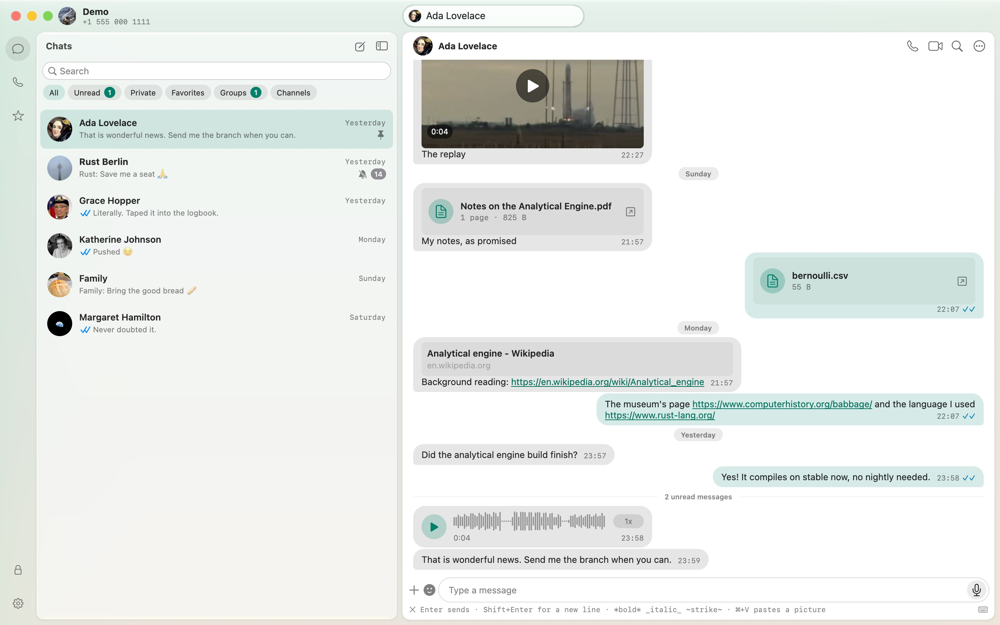

<p align="center">
  
</p>

<h1 align="center">Zap</h1>

<p align="center"><strong>WhatsApp, native on your Mac.</strong><br>
<a href="https://zap.a3lab.ai"><strong>zap.a3lab.ai</strong></a> ·
<a href="https://github.com/AdamAugustinsky/zap/releases/latest/download/Zap.dmg">Download</a> ·
<a href="https://github.com/AdamAugustinsky/zap/releases">Releases</a></p>

Zap is a WhatsApp app for macOS. Its interface is written in Go on
[go-native-ui](https://github.com/AdamAugustinsky/go-native-ui), the native UI
framework, in its Rex look. Underneath is a Rust core that links to your
phone as a companion device through
[whatsapp-rust](https://github.com/oxidezap/whatsapp-rust). There is no
browser engine and no server in between.

<picture>
  <source media="(prefers-color-scheme: dark)" srcset="site/public/assets/chat-dark.jpg">
  
</picture>

Measured against upstream ZapFast's egui app on the same core, on an Apple M4
([method and raw data](docs/measurements/zap-vs-zapfast-2026-10-27.md)):

| | Zap | ZapFast (egui) |
|---|---:|---:|
| Launch to window on screen | **137 ms** | 274 ms |
| Memory at idle | **85 MiB** | 186 MiB |
| CPU at idle | ≈ 0 | ≈ 0 |

## Install

Download [Zap.dmg](https://github.com/AdamAugustinsky/zap/releases/latest/download/Zap.dmg),
open it and drag Zap to Applications. Zap is signed with A3 Direct Solutions'
Developer ID and notarized by Apple. It needs macOS 14 or later and Apple
silicon.

Open Zap. It shows a QR code. On your phone, open WhatsApp, then Settings,
Linked devices, Link a device, and scan it.

## What is in this repository

Zap began as a fork of [ZapFast](https://github.com/crmne/zapfast) by Carmine
Paolino. That fork keeps upstream's egui app beside the Go one:

| Path | What |
|---|---|
| `gnui/` | Zap: the Go app on go-native-ui ([gnui/README.md](gnui/README.md)) |
| `zfcore/` | the Rust core as a C library, over upstream's backend ([zfcore/README.md](zfcore/README.md)) |
| `src/`, `assets/`, `tests/` | upstream ZapFast's egui app and backend, merged from upstream |
| `packaging/macos/` | the macOS bundle: `gnui-package.sh`, the checks, the icon |
| `docs/` | the migration plan, parity tables, hand tests and measurements (`docs/GNUI-MIGRATION-PLAN.md`, `docs/PARITY.md`) |
| `site/` | zap.a3lab.ai: the static site (`site/public/`), a Cloudflare Worker |

## Building

You need Go 1.27, the Rust toolchain in `rust-toolchain.toml`, and the Xcode
Command Line Tools. Check out go-native-ui beside this repository
(`gnui/go.mod` resolves it at `../go-native-ui`):

```sh
git clone https://github.com/AdamAugustinsky/go-native-ui
git clone https://github.com/AdamAugustinsky/zap
cd zap
cargo build -p zapfast_core --profile core-release   # the core
cd gnui && CGO_ENABLED=0 go run ./cmd/zapfast -demo  # the app on the demo's sample chats
```

`packaging/macos/gnui-package.sh` builds the signed `Zap.app`, the disk image
and the update archive ([docs/HANDTEST-BUILD.md](docs/HANDTEST-BUILD.md)).

## Licence and notices

MIT ([LICENSE](LICENSE)). Third-party notices: [THIRD-PARTY-NOTICES.md](THIRD-PARTY-NOTICES.md).

Zap is an unofficial client and is not affiliated with WhatsApp or Meta.
Using an unofficial client may be against WhatsApp's terms of service and
could get an account suspended. Use it at your own risk. WhatsApp is a
trademark of WhatsApp LLC.
